<div align="center">

# 🏭 AluminumSystem

### Aluminum Production Management ERP

**Track every production order through Cutting → Coloring → Packaging, measure waste at each stage, and get live analytics — secured by JWT + a bitmask-based permission system.**


[Overview](#-overview) • [Features](#-key-features) • [Screenshots](#-screenshots) • [Architecture](#-architecture) • [Business Rules](#-business-rules) • [Permissions](#-security--permissions-system) • [Getting Started](#-getting-started)

</div>

---

## 📖 Overview

**AluminumSystem** is an internal ERP built for aluminum factories. It manages the full life of a **production order**: from the moment an order is received, through the **three manufacturing stages** (Cutting, Coloring, Packaging), to final reports showing what was produced and how much was wasted at each step.

When an order arrives with a requested quantity (for example *20 units of "Corner"*), the system automatically splits its execution into three **sequential** stages, tracks each stage's quantity, the waste it generates, and the **net quantity** passed to the next stage. It is **impossible** to exceed the requested quantity or to skip the stage order — these rules are enforced by the backend, not just the UI.

### The three manufacturing stages

| # | Stage | Description |
|---|-------|-------------|
| 1️⃣ | **Cutting** | Raw aluminum is cut to the product's dimensions. |
| 2️⃣ | **Coloring** | Starts only from the **net quantity** that came out of Cutting. |
| 3️⃣ | **Packaging** | Starts only from the **net quantity** that came out of Coloring. Its output is the **final production** of the order. |

### Who uses it

| Role | Access |
|------|--------|
| **Owner** | Full control of everything, including users, roles and permissions. |
| **Production Manager / Supervisor** | Create, edit, delete and view all production data — no user/permission management. |
| **Board of Directors** | **Read-only** access to all data and reports. |

> Roles are not hard-coded: the Owner can create new roles and assign fine-grained permissions from the UI, without touching the code.

---

## ✨ Key Features

- 🔁 **Automatic order lifecycle** — one click on *Start Production* generates the 3 stages and moves the order to *In Progress*.
- 🧮 **Quantity chaining between stages** — each stage can only consume what the previous stage actually delivered (net of waste).
- 🛑 **Server-side validation** — over-production, out-of-order stages and writes on cancelled orders are all rejected with clear, localized messages.
- ♻️ **Granular waste tracking** — every waste record is tied to a **stage entry**, a **waste type** and a **waste reason** (type ≠ reason, enabling real root-cause analysis).
- 📊 **5 live, interconnected reports** — Production Summary, Orders Report, Cancelled Orders, Product Production, Product Comparison.
- 🔐 **JWT authentication + 64-bit permission bitmask** — operation-level permissions per screen, extensible without code changes.
- 🛡️ **SQL-injection safe** — 100% stored procedures with typed parameters; passwords hashed with **BCrypt**.
- 🌐 **Arabic-first, RTL interface** with a clean, responsive dashboard UI.
- 🧱 **Layered backend** — Controller → Service → Data → Stored Procedure, with a uniform `ApiResult` response envelope.

---

## 📸 Screenshots

> The UI is Arabic / RTL. All screenshots are taken from a real run with sample data.

### 1. Order management
Create orders, filter by status or product, and start production with one click. Top KPIs show total / in-progress / completed orders.

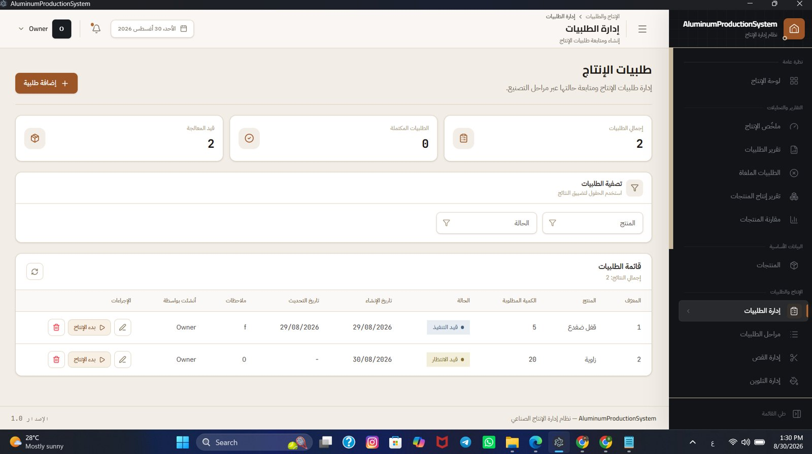

### 2. Automatic stage generation
Pressing **Start Production** creates the 3 stages (Cutting, Coloring, Packaging) with their own IDs and a progress bar per order.

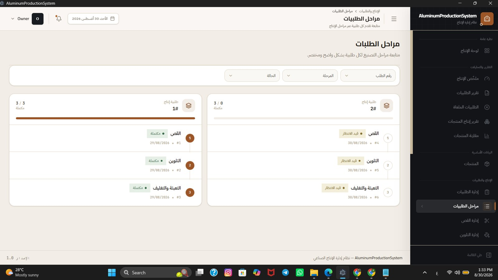

### 3. Waste registration
Waste is linked to a specific production stage, with a **type** (e.g. metal scrap) and a **reason** (e.g. operator error). It instantly affects the net quantity of the next stage and every report.

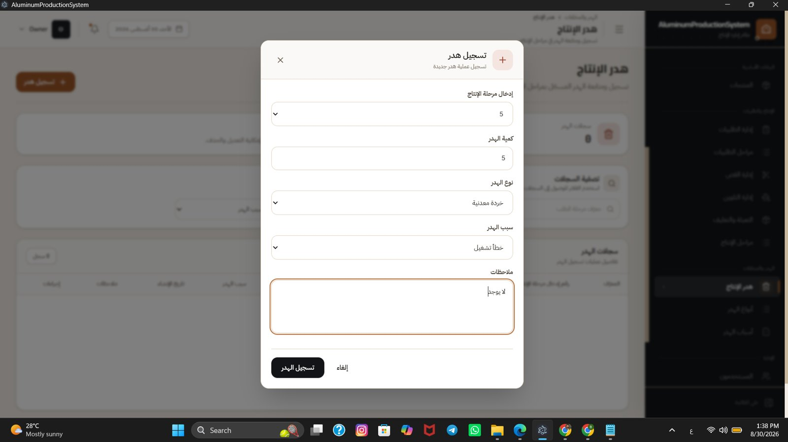

### 4. Completed stages
Once all stages are marked complete, the order card reaches **3/3**.

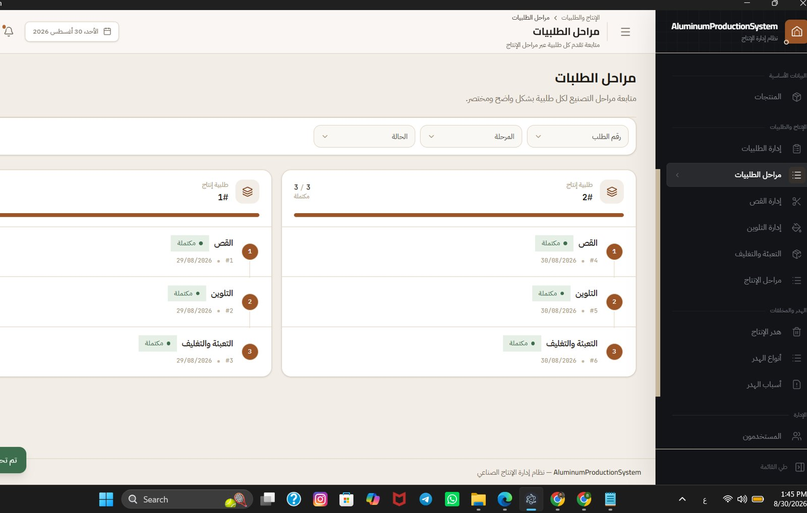

### 5. Production Summary (executive dashboard)
Overall waste ratio, completion ratio, order-status distribution and quantity movement for a selectable period.

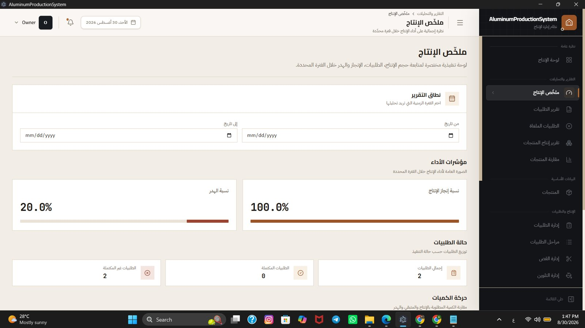
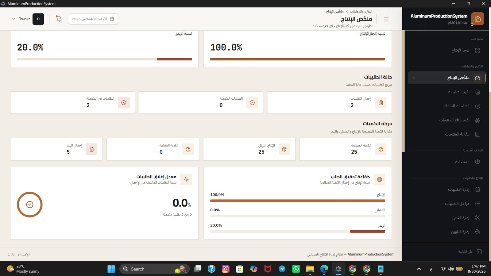

### 6. Orders Report
Per-order analysis: requested vs. final production, remaining quantity, average waste/completion, per-stage waste breakdown, and automatic *"orders needing attention"* (lowest completion, highest remaining, highest waste).

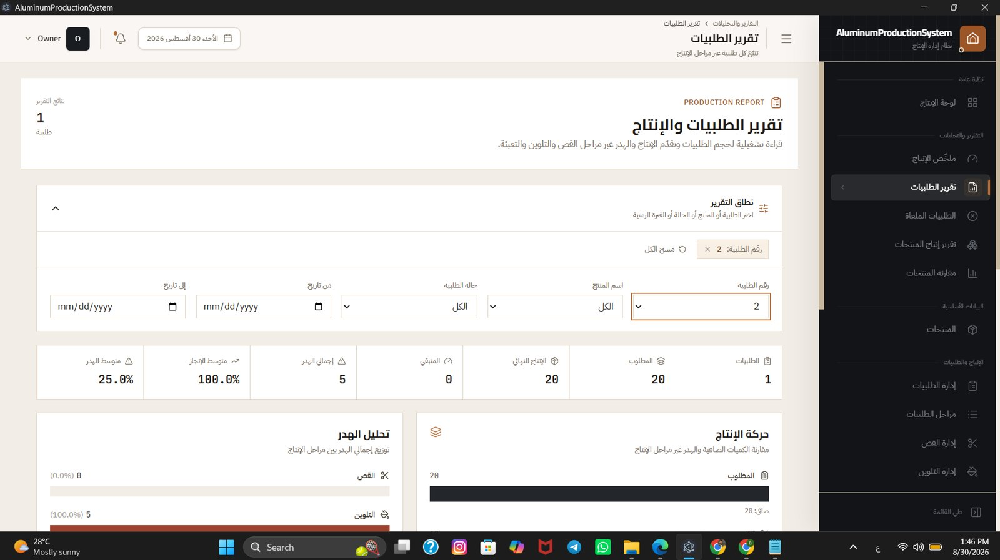
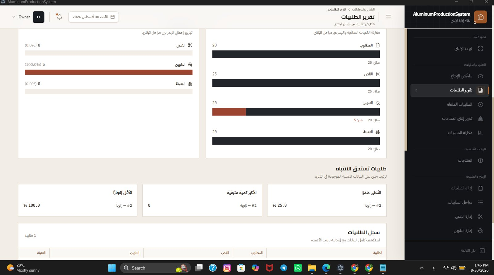

Sortable detailed log with every stage's quantity, waste and net values:

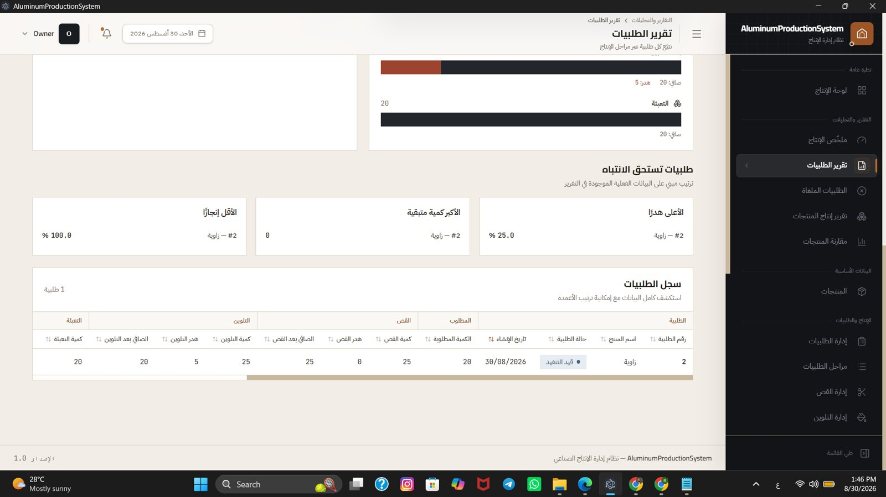
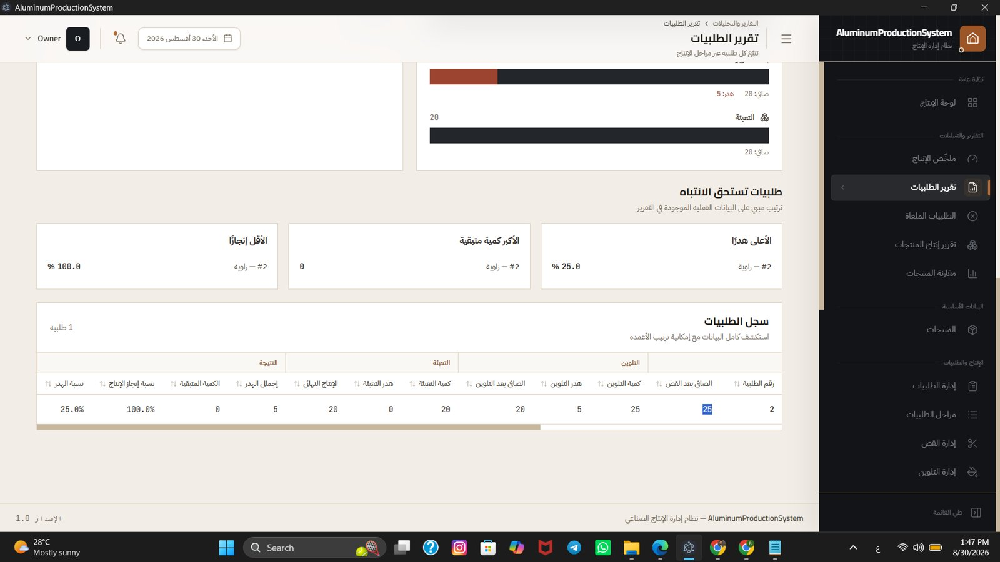

### 7. Cancelled Orders Report
An independent report for cancelled orders (including what was produced / wasted before cancellation).

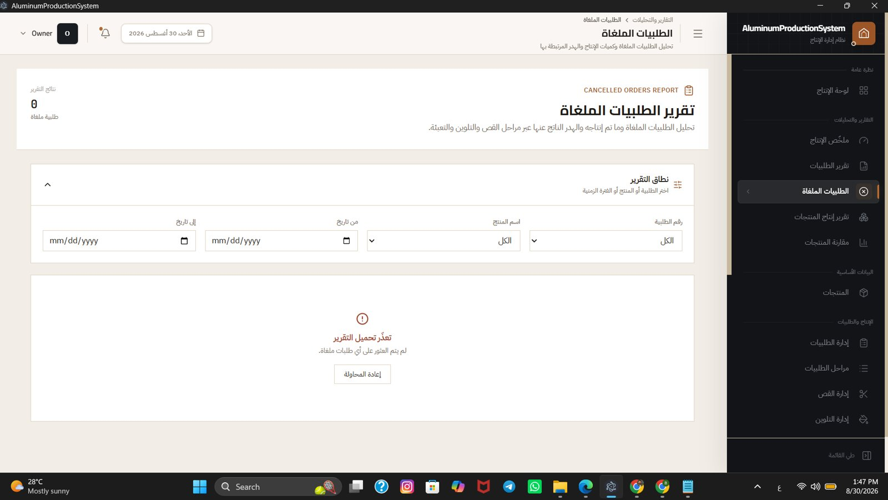

### 8. Product Production Report
Aggregates production and waste **per product** across all its orders, with stage-by-stage efficiency.

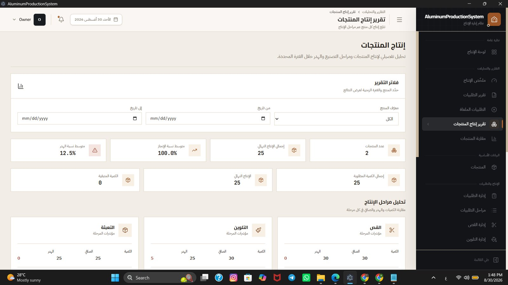
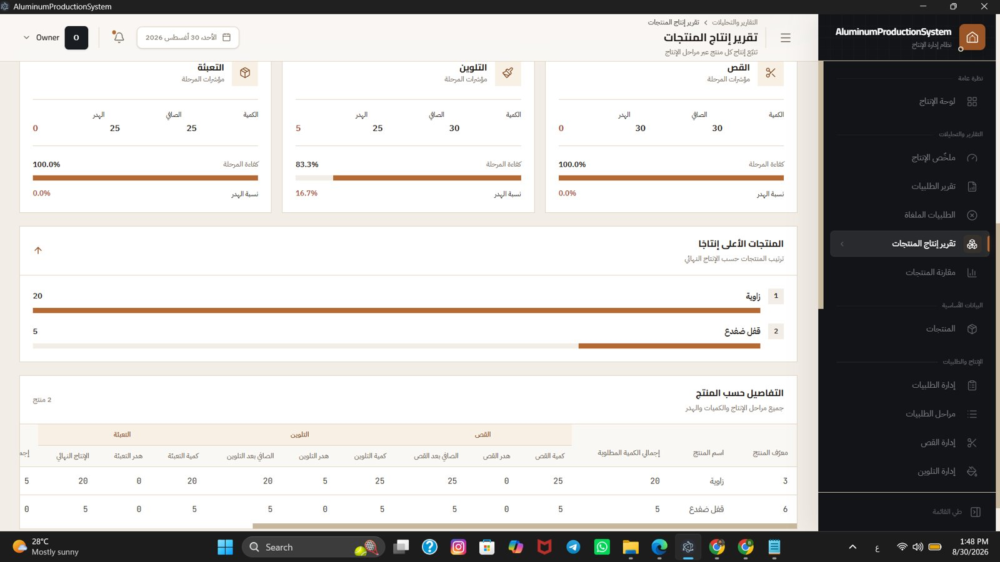

### 9. Product Comparison
Rank products by output and waste to support manufacturing-priority decisions (top producer, least waste, quality indicators).

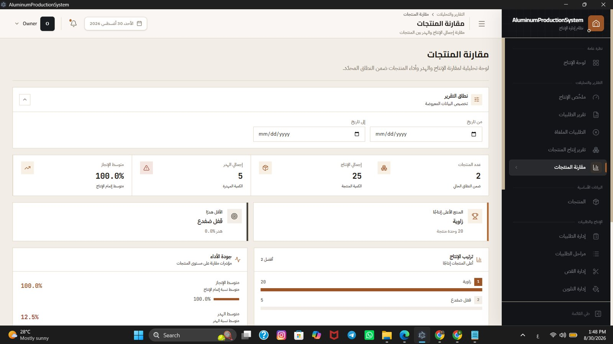
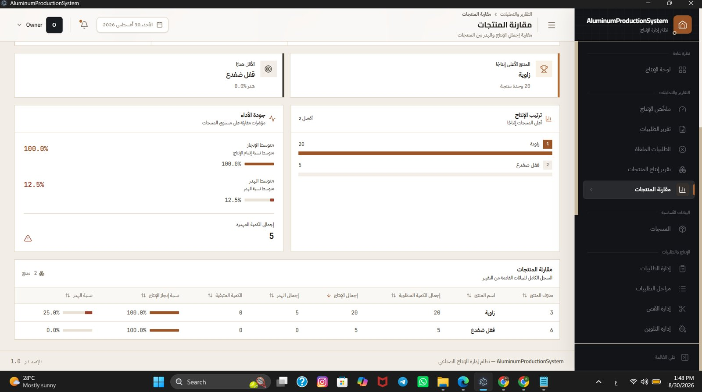

### 10. Products catalog
Master data for every product that can receive production orders. Products linked to historical orders cannot be deleted — only deactivated — to keep reports consistent.

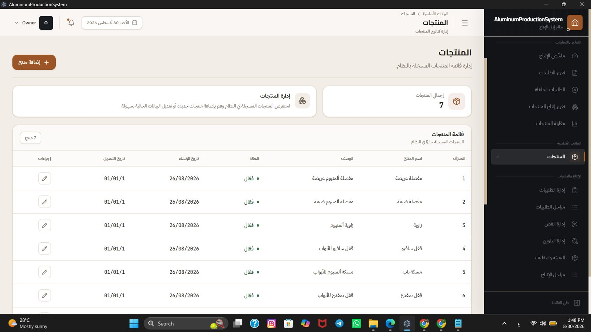

---

## 🏗️ Architecture

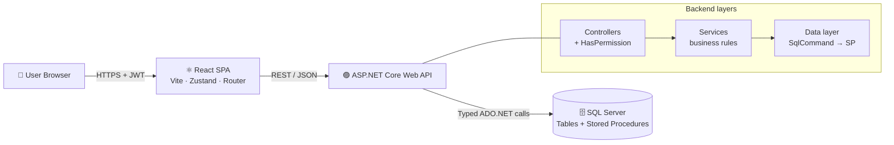

### Tech stack

| Layer | Technology |
|-------|------------|
| **Frontend** | React (Vite), React Router, Zustand, lucide-react, jwt-decode |
| **Backend** | ASP.NET Core Web API (C#), ADO.NET (`SqlCommand` + stored procedures), BCrypt.Net |
| **Database** | Microsoft SQL Server (12 tables, 50+ stored procedures, seeded reference data) |
| **Security** | JWT Bearer tokens, custom authorization policy provider, 64-bit permission bitmask |

### Backend design

Every entity follows the same layered, consistent pattern:

```
XController  →  XService  →  XData  →  SP_* (SQL Server)
   (HTTP,        (business     (ADO.NET,     (set-based logic,
  permissions)     rules)     parameters)     validation)
```

- **DTO families** per entity: `XDTO` (create), `XUpdateDTO`, `XViewDTO`, plus `SearchXRequest` for filtered queries.
- **Uniform response envelope** — every endpoint returns:
  ```json
  { "data": { }, "message": "…", "errorCode": 200 }
  ```
- **Custom authorization result handler** — returns JSON `401` / `403` (`"ليس لديك إذن للقيام بهذا الإجراء"`) instead of empty framework responses.
- **Error type mapping** — database/validation errors are mapped to proper HTTP status codes through `ErrorTypeMapper`.

### Main API modules

| Module | Purpose |
|--------|---------|
| `Login` | Authentication & JWT issuing |
| `Users`, `Roles`, `Permissions` | Identity & access management |
| `Products` | Product catalog |
| `ProductionStages`, `Statuses` | Reference data |
| `ProductionOrders` | Orders CRUD + start production |
| `ProductionOrderStages` | Stage instances per order |
| `ProductionStageEntries` | Actual production batches per stage |
| `ProductionStageWastes`, `WasteTypes`, `WasteReasons` | Waste tracking |
| `Report_ProductionSummary` | Executive KPIs |
| `Report_Orders` | Per-order analytics |
| `Report_CancelledOrders` | Cancelled orders analytics |
| `Report_ProductProduction` | Per-product aggregation |
| `Report_ProductComparison` | Cross-product comparison |

---

## 🗄️ Database

### Entity-relationship diagram

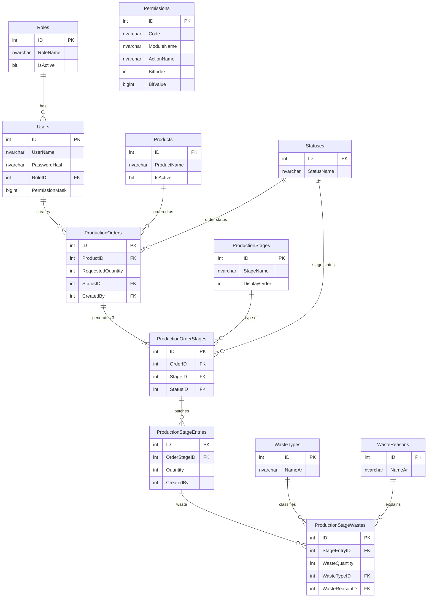

### Seeded reference data

| Table | Values |
|-------|--------|
| **Statuses** | Pending · In Progress · Completed · On Hold · Cancelled |
| **ProductionStages** | Cutting · Coloring · Packaging |
| **Roles** | Owner · Production Manager · Production Supervisor · Board of Directors |
| **WasteTypes** | Metal scrap · Manufacturing waste · Coloring waste · Unclassified |
| **WasteReasons** | Operator error · Raw-material defect · Machine malfunction · Poor storage · Unclassified |
| **Permissions** | 45 permissions across all modules (Users, Roles, Products, Orders, Stages, Entries, Wastes, Reports, …) |

> All data access is done through stored procedures (`SP_Add*`, `SP_Update*ByID`, `SP_Get*ByID`, `SP_GetAll*`, `SP_Search*`, `SP_Delete*ByID`, `SP_Login*`, `SP_SearchReport_*`).

---

## 🔄 Production Order Lifecycle

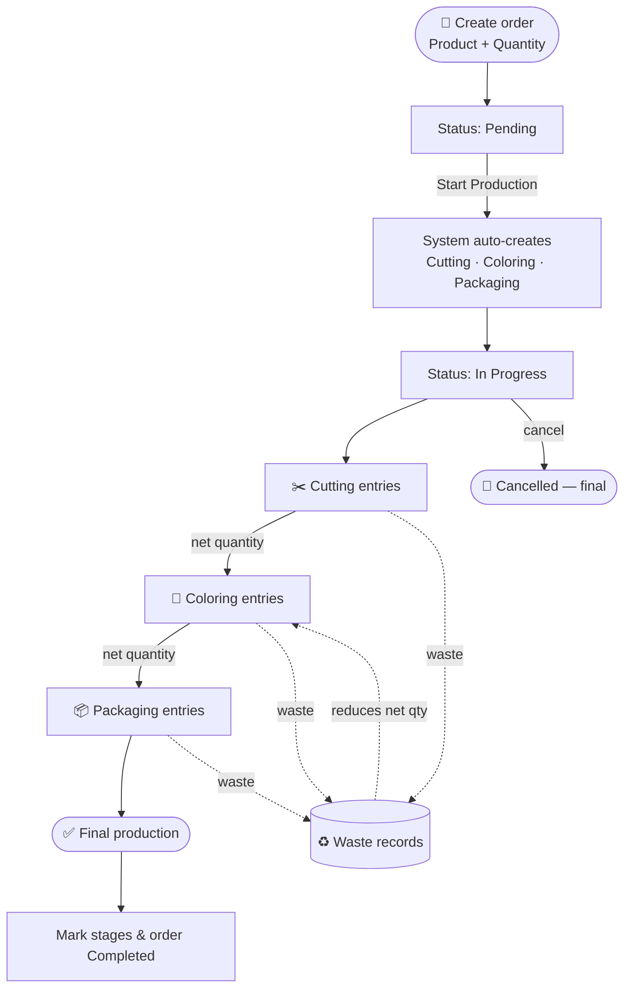

### Worked example (matches the screenshots)

Order of **20 units** of a product:

| Stage | Entered | Waste | Net passed on |
|-------|:------:|:-----:|:-------------:|
| ✂️ Cutting | 25 | 0 | 25 |
| 🎨 Coloring | 25 | **5** | **20** |
| 📦 Packaging | 20 | 0 | **20 (final)** |

→ Total waste ratio = **25%**, completion = **100%**. Trying to register Packaging before Coloring (or more than the available net quantity) is rejected with an explanatory message.

---

## 📏 Business Rules

All rules are enforced **server-side / in the database** — not only in the UI:

1. **Stage order is mandatory** — Coloring cannot exceed what Cutting delivered; Packaging cannot exceed what Coloring delivered.
2. **No over-production** — total valid quantity (including waste) can never exceed the requested quantity of the order.
3. **Cancelled orders are final** — no new production can be added; they appear only in the Cancelled Orders report.
4. **Waste is reflected immediately** — on the next stage's available quantity and on every report/percentage.
5. **View-only role** — Board of Directors can browse everything but cannot create, edit or delete anything.
6. **Products with history are never deleted** — they are deactivated to preserve historical reports.

### Common validation messages

| Message | Cause | Fix |
|---------|-------|-----|
| *Valid quantity will exceed the requested quantity…* | Entered quantity > order's requested quantity | Enter ≤ the maximum shown in the message |
| *Available quantity from the previous stage is insufficient…* | Registering Coloring/Packaging before enough previous-stage output | Register the previous stage first, or use the available quantity |
| `403` *You don't have permission for this action* | Account lacks the permission bit | Ask the Owner to grant it |
| *No cancelled orders found* | No cancelled orders in the filter range | Not an error — adjust filters |

---

## 🔐 Security & Permissions System

### Authentication
- `POST /api/LoginRequest/Login` validates credentials against a **BCrypt** hash and returns a **JWT** carrying the user's ID, email, role and `PermissionMask` as claims (signed, with expiry).
- The React app stores the token, decodes it with `jwt-decode`, and attaches it as a `Bearer` token to every request.
- Unauthenticated → **401**, authenticated without permission → **403**, both returned as JSON.

### Permission bitmask (RBAC)

Instead of join-heavy permission tables, each permission owns **one bit** of a 64-bit integer:

| Permissions table column | Meaning |
|--------------------------|---------|
| `Code` | e.g. `Users.Create` |
| `ModuleName` / `ActionName` | Screen + operation (View / Create / Update / Delete) |
| `BitIndex` / `BitValue` | The bit this permission occupies (`1 << BitIndex`) |

A user's rights are stored as a single `PermissionMask` (`bigint`). Endpoints are protected declaratively:

```csharp
[HasPermission(64)]   // the bit value of the required permission (Permissions.BitValue)
[HttpPost]
public async Task<ActionResult> Add(...) { ... }
```

At runtime a custom `PermissionPolicyProvider` + `PermissionHandler` builds the policy `Permission_<mask>` on demand and checks `(userMask & requiredMask) == requiredMask`.

**Why it's powerful:** operation-level control per screen, O(1) checks, and new roles/permissions can be created from the UI with **zero code changes**.

### Demo accounts

| Role | Email | Password |
|------|-------|----------|
| Owner | `Owner@gmail.com` | `12345` |
| Production Manager | `ProductionManager@gmail.com` | `12345` |
| Production Supervisor | `ProductionSupervisor@gmail.com` | `12345` |
| Board of Directors | `BoardDirectors@gmail.com` | `12345` |

> ⚠️ **Security notice:** `12345` is a demo password for development/demo environments only. Change all passwords from **Administration → Users** before any real deployment.

---

## 🗂️ Project Structure

```
AluminumSystem/
├── Backend/
│   └── AluminumProdctionBackend/        # ASP.NET Core Web API
│       └── ConnectionString.cs          # DB connection (do not commit secrets)
├── Frontend/
│   └── aluminum-erp/                    # React + Vite SPA
├── DataBase/
│   └── AluminumSystem_DB.sql            # Schema + stored procedures + seed data
└── docs/
    └── screenshots/                     # Images used in this README
```

Backend code is organized per entity (Controller, Service, Data, DTOs) as described in [Backend design](#backend-design).

---

## 🚀 Getting Started

> ⚠️ All **three parts** (Database, Backend, Frontend) must be running together. Follow the steps in order.

### Prerequisites

- [.NET SDK](https://dotnet.microsoft.com/download) (matching the project's target version)
- [Node.js & npm](https://nodejs.org/)
- [SQL Server](https://www.microsoft.com/sql-server) (Express or Developer edition is fine)
- [SQL Server Management Studio (SSMS)](https://learn.microsoft.com/sql/ssms/download-sql-server-management-studio-ssms)
- Visual Studio 2022 (recommended for the backend) or any C#-capable IDE

### 1. Database

1. Open **SSMS** and connect to your local SQL Server instance.
2. Open `DataBase/AluminumSystem_DB.sql`.
3. Execute the script — it creates the database, tables, stored procedures and seed data.
4. Note your server/instance name for the connection string.

### 2. Backend (.NET Core API)

1. Open `Backend/AluminumProdctionBackend` in Visual Studio (`.sln` file).
2. Open `ConnectionString.cs` and point it to your SQL Server instance and the database from step 1.
3. Restore NuGet packages (automatic in Visual Studio).
4. Run the project (`F5`, or `dotnet run` inside the project folder).
5. Confirm the API is up (console output / Swagger) and note its URL and port.

### 3. Frontend (React)

```bash
cd Frontend/aluminum-erp
npm install
npm run dev
```

Open the URL shown in the terminal (typically `http://localhost:5173`) and sign in with one of the [demo accounts](#demo-accounts).

### Running order

1. **SQL Server** (usually already a Windows service)
2. **Backend API** — must be running before the frontend
3. **Frontend** — `npm run dev`

### Troubleshooting

- **Frontend can't reach the backend** → make sure the API URL/port in the frontend's API config matches where the backend runs.
- **CORS error** → the backend currently allows `http://localhost:5173` only; add your frontend origin if it differs.
- **Database connection error** → recheck the connection string and that the SQL Server service is running.
- Never commit real credentials in `ConnectionString.cs` or `appsettings.json` — use `appsettings.Development.json` (git-ignored) or environment variables.

---

## 🧭 Roadmap

- [ ] Force password change on first login
- [ ] Move the API base URL to environment variables (`.env` per environment)
- [ ] Restrict CORS to the real company domain on deployment
- [ ] Notifications (in-app / email) when a stage completes or waste exceeds a threshold
- [ ] Automated unit & integration tests
- [ ] Docker Compose for one-command startup
- [ ] Export reports to PDF / Excel

---

## 📊 Project Evaluation

| Area | Score |
|------|:-----:|
| Business logic & production rules | **8.5 / 10** |
| Database design | **8 / 10** |
| Security | **7.5 / 10** |
| UX / UI | **8 / 10** |
| **Overall** | **8 / 10** |

A complete, practically-ready system for a small-to-medium factory with a strong, realistic business-logic layer; it needs only small security hardening before real deployment.

---

## 🇸🇾 نبذة بالعربي

**AluminumSystem** نظام داخلي لإدارة إنتاج الألمنيوم في المصنع. يستلم طلبية إنتاج بكمية معينة، ويقسّم تنفيذها تلقائياً على ثلاث مراحل متتابعة (**القص ← التلوين ← التعبئة والتغليف**)، ويتابع الكمية والهدر في كل مرحلة والكمية الصافية المنتقلة للمرحلة التالية، بحيث يستحيل تجاوز الكمية المطلوبة أو تخطي ترتيب المراحل. يوفّر خمسة تقارير مترابطة (ملخّص الإنتاج، تقرير الطلبيات، الطلبيات الملغاة، إنتاج المنتجات، مقارنة المنتجات)، ونظام صلاحيات دقيق (JWT + Bitmask) يسمح ببناء أدوار جديدة دون تعديل الكود.

---

## 👤 Author

**Baraa Mardini** — .NET Backend Developer · Damascus, Syria

- GitHub: [@BaraaMardini](https://github.com/BaraaMardini)

---

<div align="center">

⭐ If you find this project useful, consider giving it a star!

</div>
